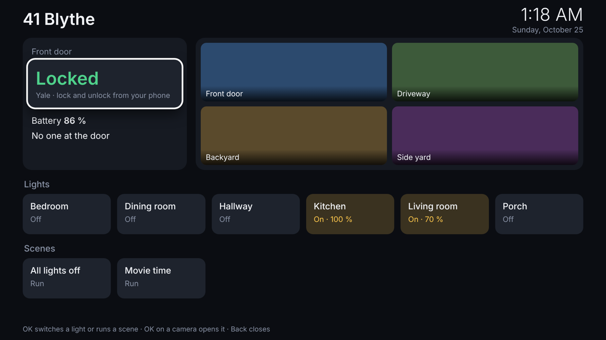

# The Samsung TV (QN82Q850TAFXZA)

An 82" Samsung from 2020 running **Tizen**. cleanyourtv's Android route (ADB, `pm disable-user`, a new
launcher) does not exist here: Tizen has no ADB, no shell, and Samsung Home can't be replaced
(cleanyourtv's notes: `../cleanyourtv/docs/devices/samsung-tizen.md`). What Tizen *does* offer:

| Way in | Port | Needs | What it can do |
|---|---|---|---|
| **Remote-control API** | 8001 / 8002 | "Allow" once on the TV | Everything the remote can: keys, open apps, open the web browser at a page, read model and power state |
| **Developer Mode + SDB** | 26101 | Developer Mode on, a Samsung developer certificate | Install your own app (the house dashboard below). Not a shell: no uninstalling Samsung's apps, no root |
| **Network DNS** | 53 on the hub | AdGuard Home or Pi-hole | Block Samsung's ad and viewing-data servers |

So "fixing" this TV is: switch off its tracking (1), block its ad servers (2), and put the house on it
with your own app (3). Every step is undone from the TV's own menus.

All commands run on a computer **on the house Wi-Fi**, from this folder:

```bash
cd tv/samsung
python3 -m venv venv && venv/bin/pip install -r requirements.txt
export TV_HOST=192.168.1.115        # the TV, from Settings → General → Network → Network Status → IP Settings
venv/bin/python tvctl.py info       # should print the model and developerMode
venv/bin/python tvctl.py pair       # choose Allow on the TV
```

## 1. Switch off the tracking

```bash
venv/bin/python tvctl.py privacy
```

opens the TV's menu and walks you through each setting, one at a time, waiting while you change it
with the remote:

| Setting | Set to |
|---|---|
| Support → Terms & Policy → **Viewing Information Services** (ACR: reports what's on screen, HDMI included) | Off |
| Support → Terms & Policy → **Interest-Based Advertisement** | Off, and Reset PSID |
| Support → Terms & Policy → **Voice Recognition Services** | Off, unless you use Bixby |
| General → Smart Features → **Autorun Smart Hub** | Off: no Samsung home screen with promoted rows at power-on |
| General → Smart Features → **Autorun Last App** | On: comes back to what was on, or the dashboard app |
| General → Network → Expert Settings → **Power On with Mobile** | On: lets Home Assistant switch the TV on |
| Support → Software Update → **Auto Update** | Leave on: security fixes |

Leave the Smart Hub terms accepted: declining them switches off the app store and the streaming apps.
Photograph each screen before changing it, so you can set it back.

## 2. Block the ad servers

[`blocklist.txt`](blocklist.txt) is a conservative list: Samsung Ads (the banners and promoted tiles),
and ACR's reporting servers. Apps, the app store and updates keep working.

1. On the hub, install **AdGuard Home** (HA OS: Settings → Add-ons → AdGuard Home; Docker:
   `adguard/adguardhome`). Filters → **Custom filtering rules** → add each domain from `blocklist.txt`
   as `||samsungads.com^` (one per line; this blocks its subdomains too).
2. Point **only the TV** at it: on the TV, Settings → General → Network → Network Status → IP Settings →
   DNS Setting → **Enter manually** → the hub's IP.
3. Check Netflix, YouTube and the app store still work. To undo: DNS Setting → **Obtain automatically**.

The community [SmartTV list](https://raw.githubusercontent.com/Perflyst/PiHoleBlocklist/master/SmartTV.txt)
blocks much more, but can break the Samsung app store and app icons. YouTube's in-video ads can't be
blocked by DNS at all.

## 3. The house on the TV

### Quick: the browser (no Developer Mode)

```bash
venv/bin/python tvctl.py browse http://<hub ip>:8123/dashboard-tv/home
```

opens Home Assistant's TV dashboard (`../../homeassistant/config/dashboards/tv.yaml`) in the TV's web
browser. Log in once with the remote. Works today, but the browser is slow and the pointer is fiddly.

### Proper: the "41 Blythe" app (Developer Mode)

[`app/`](app/) is a small Tizen app built for the remote: the Yale lock's state, battery and "someone is
at the door", the Lorex cameras (OK opens one full screen), Lutron lights (OK switches) and scenes.
**The lock is shown only: the TV can't unlock the door.** It talks straight to Home Assistant with a
token packed into the app.



**a. Turn on Developer Mode on the TV**

1. Open **Apps** (Home → Apps).
2. Press **1 2 3 4 5** (on the One Remote, press the **123** button for the number pad).
3. Developer mode **On**. **Host PC IP = your computer's IP address, not the TV's** (on a Mac:
   System Settings → Wi-Fi → Details; Windows: `ipconfig`).
4. OK, then restart the TV: hold the remote's power button until the Samsung logo appears.
5. Check: `venv/bin/python tvctl.py info` shows `developerMode 1` and your computer's IP as `developerIP`.

**b. Install Samsung's tools** (once, about 1 GB)

1. Install the [Tizen Studio CLI](https://developer.tizen.org/development/tizen-studio/download)
   (the "CLI installer"), then in its Package Manager install **Samsung Certificate Extension** and
   **TV Extensions**. Don't run the graphical and CLI package managers at the same time.
2. Connect: `~/tizen-studio/tools/sdb connect 192.168.1.115:26101`, then `sdb devices` shows the TV.
3. Make a **Samsung** certificate (Certificate Manager → Samsung → TV → sign in with a Samsung account →
   Distributor: **Public**, add the TV's DUID, which the Certificate Manager reads from the connected TV).
   Name the profile `blythe`. Keep the certificate files and password out of git.

**c. Build and install**

```bash
cp app/config.example.js app/config.js     # hub IP, and a Home Assistant long-lived token named "Samsung TV"
~/tizen-studio/tools/ide/bin/tizen build-web -- "$PWD/app"
~/tizen-studio/tools/ide/bin/tizen package -t wgt -s blythe -- "$PWD/app/.buildResult"
~/tizen-studio/tools/ide/bin/tizen install -n BlytheHome.wgt -s 192.168.1.115:26101 -- "$PWD/app/.buildResult"
```

The package file name must not contain spaces (Samsung's installer fails silently on them); rename the
`.wgt` to `BlytheHome.wgt` if needed. The app then appears under Apps; add it to the Home bar with the
remote (select it → Add to Home). With Autorun Last App on, the TV reopens it at power-on if it was the
last thing open.

To try it without a TV: put `demo: true` in `config.js` and open `app/index.html` in Chrome at
1920×1080; arrow keys, Enter and Escape act as the remote.

**Tested:** in Chromium at 1920×1080, in demo mode and against a stand-in Home Assistant server (states,
toggles, camera pictures and the remote keys). **Not yet run on the Samsung itself**: on Tizen, the
`<access origin="*">` line in `config.xml` is what lets the app call Home Assistant on another
address. If the app shows "Can't reach Home Assistant" on the TV while Chrome works, that is the
place to look.

Developer Mode can be switched off again once the app is installed (the app stays). Turn it back on to
update the app.

## Home Assistant control

Add the **Samsung Smart TV** integration (`../../homeassistant/SETUP.md`, section 6) with the TV's IP
and accept **Allow** on the TV: power, volume, inputs and app launch from Home Assistant and its
automations. It can launch the 41 Blythe app by its ID, `BlytheHom0.BlytheHome`
(`media_player.play_media`, type `app`).

## Give it a fixed address

In the router, reserve 192.168.1.115 for the TV (DHCP reservation), so the scripts, Home Assistant and
the DNS setting keep working. Keep the TV's serial number, MAC and DUID out of this repo and public posts.

## If you'd rather have Android

A **Google TV Streamer** on one of the Samsung's HDMI ports runs everything in [`../README.md`](../README.md):
the cleanyourtv debloat and launcher, the Smart Home card, Frigate Glance camera pop-ups, and casting.
Turn on Anynet+ (HDMI-CEC) so one remote runs both.
